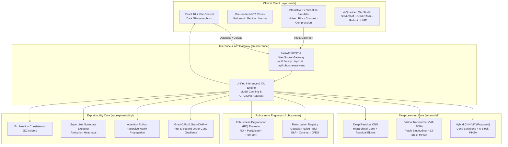

# PulmoTrust AI – System & Research Architecture

## High-Level Architecture

---

## 1. Deep Learning Model Architectures

### A. Proposed Hybrid CNN–Vision Transformer (`src/model/hybrid.py`)
- **Conv Backbone**: 3 residual convolution stages reducing spatial dimensions from $224 \times 224$ to $14 \times 14$ while expanding channels to $D = 256$.
- **Transformer Encoder**: 6 transformer encoder blocks with $h = 8$ attention heads and $d_{\text{head}} = 32$. Prepend learnable `[CLS]` token and add 1D learnable position embeddings.
- **Classification Head**: LayerNorm followed by linear projection to 3 diagnostic classes: Malignant, Benign, Normal.
- **Advantage**: Combines inductive spatial priors (translation invariance, edge detection) with unrestricted receptive fields of self-attention.

### B. Vision Transformer (`src/model/vit.py`)
- Standard ViT with patch embedding ($16 \times 16$ non-overlapping patches), multi-head self-attention, and classification head.

### C. Deep Residual CNN (`src/model/cnn.py`)
- Custom 4-stage residual convolutional neural network with BatchNorm, ReLU, and Global Average Pooling.

---

## 2. Robustness Analysis Framework (`src/robustness/`)

### Systematic Image Perturbations:
1. **Gaussian Noise**: $\sigma \in \{15, 30, 50\}$
2. **Gaussian Blur**: radius $\rho \in \{1.5, 3.0, 5.0\}$
3. **Salt-and-Pepper Noise**: probability $p \in \{0.02, 0.05, 0.10\}$
4. **Contrast Adjustment**: dynamic range factors $\alpha \in \{0.5, 1.5\}$
5. **Lossy JPEG Compression**: quality factors $Q \in \{30, 10\}$
6. **Patient Motion / Rotation**: $\theta \in \{5^\circ, 15^\circ, 30^\circ\}$

### Mathematical Robustness Formulation:
$$RD = \mathcal{M}(\mathbf{X}_{\text{clean}}) - \mathcal{M}(\mathcal{T}_k(\mathbf{X}))$$
where $\mathcal{M}$ represents classification accuracy or target class softmax probability.

---

## 3. Multi-Modal Explainable AI (XAI) Pipeline (`src/explainability/`)

1. **Grad-CAM**: Evaluates first-order gradient of target class score $Y^c$ with respect to the last convolutional feature maps $A^k$.
2. **Grad-CAM++**: Utilizes second-order positive gradient weights to resolve multi-focal micro-nodules.
3. **Attention Rollout**: Computes cumulative self-attention propagation across all transformer blocks:
   $$\mathbf{A}_{\text{rollout}} = \prod_{l=1}^L \left(0.5 \mathbf{A}_l + 0.5 \mathbf{I}\right)$$
4. **LIME**: Local interpretable model-agnostic explanations perturbing image superpixels.
5. **Explanation Consistency ($EC$)**:
   $$EC = \frac{2 \sum \mathbf{M}_{\text{clean}} \odot \mathbf{M}_{\text{pert}}}{\sum \mathbf{M}_{\text{clean}}^2 + \sum \mathbf{M}_{\text{pert}}^2}$$
